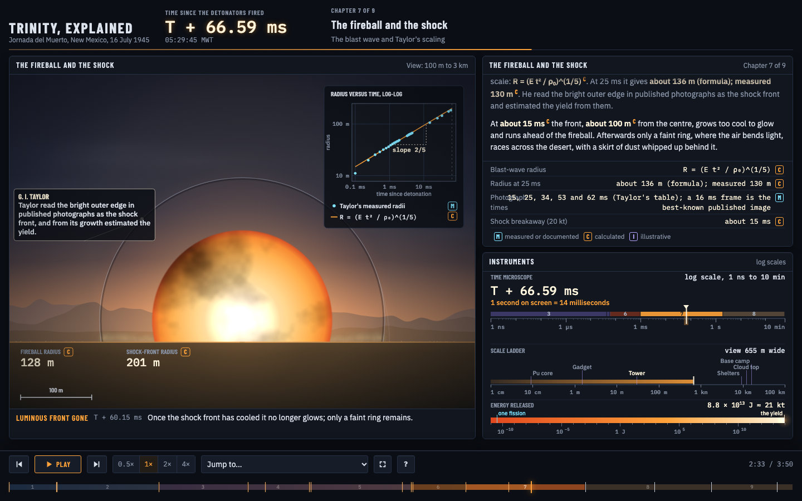

# Trinity, explained

**[Watch it live](https://martha889.github.io/trinity-explained/)** · [Source on GitHub](https://github.com/martha889/trinity-explained)

An animated, scientific explainer of the Trinity nuclear test (16 July 1945): how an implosion device works, from the detonation to the
cloud and what was left, on a clock that runs from nanoseconds to minutes. One offline HTML page: Canvas 2D, vanilla JavaScript, no dependencies,
assembled by a Python build script.



## Build, run, test

```
python3 build.py                      # writes dist/trinity.html (stdlib only; validates content, facts and the physics tables)
open dist/trinity.html                # no server needed; deep links: #t=<playback seconds>, #<chapter-id>, #<chapter-id>@<0..1>
python3 tools/smoke.py --sweep 46 --shots /tmp/shots            # headless Chrome: errors, ink, overflow, event strip, screenshots
python3 tools/smoke.py --sweep 18 --size 390x844                # phone size, in a true-size iframe
python3 tools/smoke.py --play --phases                          # plays across every chapter boundary: one flash, no flicker
python3 tools/smoke.py --sweep 18 --rm                          # forced reduced motion (the page accepts &rm in the hash)
python3 sim/trinity_sim.py                                      # physics self-checks
```

`$CHROME` overrides the Chrome path. Keys: Space play/pause, arrows previous/next event, 1 to 4 speed, F theatre mode, ? help.
`PLAN.md` is the design contract and `src/API.md` documents the modules for scene and content authors.

## Time model

Playback seconds are the master clock; the nine chapters are laid end to end (3 min 50 s at 1x). Each chapter maps its progress to physical time
since the detonators fired (T = 0) linearly, logarithmically or held, and the time microscope shows the resulting slow-motion factor in words.
Scenes are pure functions of that time, so any frame can be jumped to directly.

## Provenance tags

Every number on screen carries a chip: **M** measured or documented, **C** calculated from a stated formula, **I** illustrative. Numbers in the
copy come only from `data/facts.json` (`{{key}}` in `content/*.json`), each with its tag, source and link; the physics tables in
`sim/trinity_sim.py` carry the same tags.

## Sources

- [LANL National Security Science 'The Trinity Test' (2020)](https://www.lanl.gov/media/publications/national-security-science/0720-the-trinity-test)
- [Groves memo to Sec. of War, 18 Jul 1945 (FRUS)](https://history.state.gov/historicaldocuments/frus1945Berlinv02/d1305)
- [Fermi's account (Dannen archive)](https://www.dannen.com/decision/fermi.html)
- [Wikipedia 'Fat Man'](https://en.wikipedia.org/wiki/Fat_Man)
- [Wikipedia Trinity (6.19 kg)](https://en.wikipedia.org/wiki/Trinity_(nuclear_test))
- [Glasstone & Dolan, Effects of Nuclear Weapons, 1977, sec. 1.43-1.45](https://atomicarchive.com/resources/documents/effects/glasstone-dolan/chapter1.html)
- [Popular convention (Rhodes](https://en.wikipedia.org/wiki/Shake_(unit))
- [LANL 1663 'Revising Trinity'](https://www.lanl.gov/media/publications/1663/0922-revising-trinity)
- [Selby et al., Nucl. Technol. 207 (2021)](https://arxiv.org/abs/2103.06258)
- [Glasstone & Dolan ch. 2](https://atomicarchive.com/resources/documents/effects/glasstone-dolan/chapter2.html)
- [Taylor, Proc. Roy. Soc. A 201 (1950) 159 and 175](https://en.wikipedia.org/wiki/Taylor%E2%80%93von_Neumann%E2%80%93Sedov_blast_wave)
- [Own arithmetic](https://www.phys.uconn.edu/~rozman/Courses/P2200_25F/downloads/trinity-test.data)
- [Taylor (1950) Table 1](https://commons.wikimedia.org/wiki/Trinity_test)
- [Glasstone & Dolan 1977, sec. 2.121](https://www.abomb1.org/nukeffct/airburst.html)
- [Glasstone & Dolan 1977, sec. 7.03, 7.85, 2.126](https://atomicarchive.com/resources/documents/effects/glasstone-dolan/chapter7.html)
- [NASA Sun Fact Sheet](https://nssdc.gsfc.nasa.gov/planetary/factsheet/sunfact.html)

## Scope

The device is drawn as a labelled, concentric cutaway at popular-science level: what each layer is for, with no dimensions or design detail.
Trinity was a test in the New Mexico desert; ranchers and villagers downwind were not warned or evacuated and received fallout, and 24 days later,
on 9 August 1945, the same plutonium implosion design was used on Nagasaki. The last chapter says so plainly.
